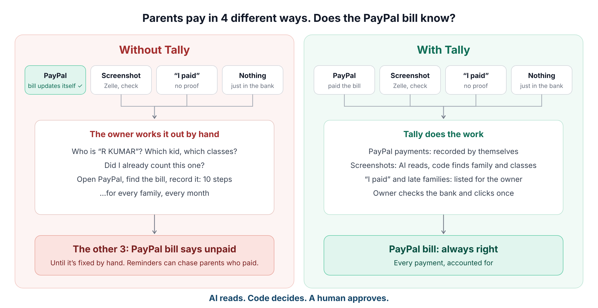
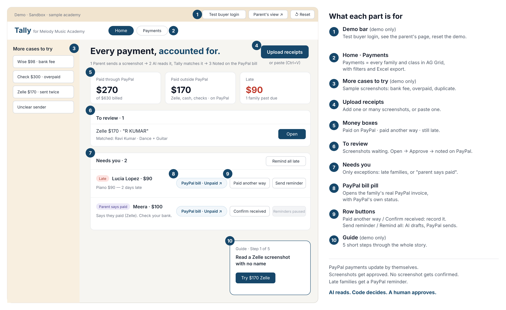
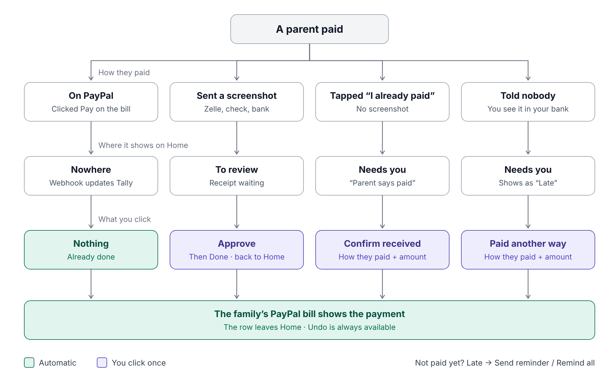
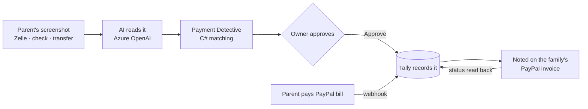

# Tally — Every payment, accounted for

**Tally helps small academies and teachers keep PayPal bills accurate, even when parents pay another way.**

## 🌐 Live demo

| Resource | Link |
|---|---|
| 🎥 **Demo video** (under 3 min) | [Watch on YouTube](https://youtu.be/XZnnA38ieS8) |
| **Live app** (hosted on Render) | https://tally-academy.onrender.com |
| **PayPal Sandbox test buyer** | See [Try it in 2 minutes](#try-it-in-2-minutes) |



Parents pay class fees through PayPal, Zelle, bank transfers, checks, cash or UPI — often with no name or note
("$170 Zelle from R KUMAR"). The owner has to work out *which family* and *which classes* each payment covers,
and PayPal keeps showing those families as unpaid.

Tally fixes that:

1. **A parent sends a screenshot** of their payment.
2. **AI reads it** (amount, date, sender, method), and **Tally matches it** to the right family and classes.
3. **The owner approves** — and Tally **notes the payment on the family's real PayPal invoice**.

PayPal and Tally always agree, whether the family paid through PayPal or not. Small academies want PayPal to be
their one source of truth, so Tally keeps it that way: every payment ends up on the family's PayPal invoice, and
every remaining balance and reminder comes with a **Pay with PayPal** button.

> Built for the Devpost **Build What's Next with PayPal and AI** hackathon. Runs on the **PayPal Sandbox** with a
> sample academy — no real money, no real people.

---

## Who it's for

Anyone who collects **recurring fees from families or members** and gets paid in more than one way:

- music, dance and art schools · tutors and coaching centres
- sports clubs and swim lessons · daycares and after-school programs
- community classes and clubs

The demo uses a music academy, but nothing is music-specific: Tally works with **organizers, classes (offerings),
price plans, families (payers) and members**, so the same flow fits any of these.

---

## Less work for the owner

One parent's "$170 Zelle from R KUMAR" — what the owner has to do:

| By hand: **10 steps** | With Tally: **1 click** |
|---|---|
| 1. Check the chat for the screenshot<br>2. Check the bank app<br>3. Open the spreadsheet<br>4. Work out who "R KUMAR" is<br>5. Work out which classes $170 covers<br>6. Mark them paid<br>7. Open PayPal<br>8. Find the family's invoice<br>9. Record the payment (amount, date, method)<br>10. Check the invoice status | The parent uploads the screenshot from their family link (or the owner pastes it).<br><br>Tally reads it, finds the family, checks every class combination, and shows the match.<br><br>Owner: **Approve & note on PayPal** — the PayPal invoice is updated automatically. |

The two easiest mistakes by hand — picking the wrong classes, or forgetting to update PayPal — are the two
things Tally does for you.

And for the families who pay **through PayPal**, the owner does **nothing** — the webhook records it.

---

## Try it in 2 minutes

**Live demo:** https://tally-academy.onrender.com

1. Open the site and click **Guide** (bottom-right). It walks you through 5 short steps.
2. Or explore on your own: try a receipt from **More cases to try** (left), open **Parent's view ↗**, or pay a family's
   bill from its **PayPal bill ↗** pill.
3. Clicked something out of order? The guide says so and offers **Start the guide fresh**, so you're never stuck.

**PayPal Sandbox test buyer** (fake money, works only on sandbox.paypal.com — also under **Test buyer login** in the app):

| Email | Password |
|---|---|
| sb-agnwz53636700@personal.example.com | TallyJudge2026! |

Good to know:

- **Shared demo.** Everyone uses the same sample academy. It **starts fresh by itself after 30 minutes of no
  activity**, or use **↺ Reset** (top-right).
- **Free hosting.** The first visit after a quiet period can take up to a minute while the database wakes up.
- **PayPal updates arrive by webhook** within seconds. Coming back to the Tally tab after paying also checks
  PayPal straight away.

---

## What's on the screen



## The 4 ways a payment arrives



**Rule of thumb:** PayPal payments update by themselves. A screenshot gets **Approve**.
No screenshot gets **Confirm received** (or **Paid another way** if the parent didn't say).
Not paid yet? **Send reminder**, which goes out through PayPal with a Pay button.

---

## How it works



**The rule behind it: _AI reads, code decides, a human approves._**

- The **AI only reads** the screenshot and **writes reminder text**. It never decides who paid or how much, and
  never moves money.
- The **Payment Detective** is plain C#. It finds the family (even from "R KUMAR") using past payment names, then
  checks **every combination** of open classes to see which ones the amount covers — and explains why, with
  strong / medium / weak evidence.
- **Nothing counts until the owner approves**, because a screenshot isn't proof the money arrived; only the
  owner can check the bank. Every approval can be **undone** (including on PayPal).

### What the Detective handles

| Case | What happens |
|---|---|
| No name, no note | Matches "R KUMAR" to Ravi from past payments |
| Exact fit | $170 = only Dance $90 + Guitar $80 (checked 7 combinations) |
| Bank fee | $88.20 sits within a small tolerance of a $90 class |
| Overpaid | A $300 check pays 3 classes; $30 becomes family credit |
| Duplicate | The same screenshot twice is caught by its SHA-256 fingerprint — and not sent to the AI again |
| Unclear | "Needs a look", with the reason; Tally never guesses |
| Part payment | $150 fills the oldest charges first; the rest stays on the PayPal bill |
| Already paid | Family has nothing open: "Dismiss · nothing to record", nothing changes on PayPal |
| Two families fit | Same amount, no clear sender: Tally shows both and asks you to pick |

---

## Where PayPal is used

| PayPal capability | How Tally uses it |
|---|---|
| **Invoicing API v2 — create & send** | Tally creates and sends each family's monthly PayPal bill |
| **Invoicing API v2 — record external payment** | Zelle / check / cash payments approved in Tally are written onto the PayPal invoice |
| **Invoicing API v2 — delete external payment** | **Undo** in Tally removes the note from PayPal too |
| **Invoicing API v2 — remind** | AI-written reminders (in the family's language) go out through PayPal, with a Pay button |
| **Invoice status read-back** | Tally shows PayPal's own status (e.g. `SENT → PARTIALLY_PAID → PAID`) after every change |
| **Webhooks** (`INVOICING.INVOICE.PAID`, …) | When a family pays on PayPal, Tally updates by itself. Signatures are verified; each event is processed once |
| **Idempotency** (`PayPal-Request-Id`) | Retries never record a payment twice |

---

## Where AI is used (and where it isn't)

| | Tool | Job |
|---|---|---|
| ✅ | **Azure OpenAI (gpt-4o-mini) via Semantic Kernel**, structured outputs | Read a payment screenshot into amount, date, sender, method, reference |
| ✅ | Same | Draft a friendly reminder in the family's language (template fallback if AI is unavailable) |
| ❌ | — | Matching, money math, fees, credit, approvals — **all deterministic C# (`decimal`)** |

**Privacy by design:** the receipt reader never sees your families list; it only gets the image. The reminder
writer sees only the one family it's writing to. Finding the family is Tally's own code.

---

## Many receipts? Many families?

- **Parents upload their own** screenshots from their private family link — the owner doesn't have to.
- **Bulk upload or paste (Ctrl+V)** many screenshots at once; Tally reads them one by one.
- **Sure matches arrive pre-ticked** → one click: *Approve & note on PayPal*. Unclear ones wait in "Needs a look".
- **Remind all late families** in one go: AI drafts each reminder (in each family's language), you untick anyone
  you want to skip, and PayPal sends them with a Pay button.
- **Needs you shows only exceptions.** PayPal payments and matched receipts update by themselves; only late or
  unconfirmed families appear there.

---

## Built with

- **Backend:** .NET 10, ASP.NET Core, EF Core 10, SQL Server / **Azure SQL** (serverless), retry strategy,
  row-version concurrency
- **PayPal:** Invoicing API v2, Webhooks (signature verification), Sandbox
- **AI:** **Azure OpenAI** (gpt-4o-mini) via **Semantic Kernel**
- **Messaging:** **Azure Service Bus** queue for webhooks (dead-letter after 5 tries), in-memory fallback
- **Frontend:** React, TypeScript, Vite, Tailwind CSS, shadcn/ui
- **AG Grid Enterprise:** the Payments page — families grouped with their classes, status pills, quick filters,
  totals row and Excel export
- **Render:** Docker (multi-stage) deploy with health check and auto-deploy on push
- **Tests:** xUnit (`tests/Tally.Tests`)

---

## Run it yourself

You need: **.NET 10 SDK**, **Node 22+**, **Docker** (for SQL Server), a **PayPal Sandbox** app, and an
**Azure OpenAI** deployment.

```bash
# 1. Settings: see .env.example for every setting (names only)
#    Local dev uses user secrets, e.g.:
cd src/Tally.Api
dotnet user-secrets set "ConnectionStrings:TallyDb" "<your local connection string>"
dotnet user-secrets set "PayPal:ClientId" "<sandbox client id>"
# ...and the rest from .env.example (use ":" instead of "__")

# 2. Database (SQL Server in Docker)
docker compose up -d
dotnet ef database update --project src/Tally.Infrastructure --startup-project src/Tally.Api

# 3. API
dotnet run --project src/Tally.Api

# 4. Web app (new terminal)
cd web
npm install
npm run dev        # http://localhost:5173
```

**Or run everything in one container:**

```bash
docker build --build-arg VITE_AG_GRID_LICENSE_KEY=<your key> -t tally .
docker run --env-file .env -p 8080:10000 tally   # http://localhost:8080
```

> Locally, PayPal webhooks can't reach your laptop. Tally covers that by asking PayPal directly when you return
> from a PayPal tab (or **Check with PayPal** in the guide).

---

## Known limitations

- **Shared demo:** visitors at the same moment see each other's actions. It starts fresh after 30 idle minutes.
- **Free hosting:** the first visit after a quiet period can take up to a minute.
- **A bank-fee difference stays visible as owed** (e.g. $1.80); the owner decides. Tally never hides a difference.
- **Sandbox only;** one organizer per deployment (one sample academy in the demo).

## What's next

- Automatic reminders on a schedule
- Forward receipts by email or chat instead of uploading
- "Count a close match as paid in full (bank fee)" option
- CSV import for students, classes and prices
- Several organizers in one Tally (separate accounts and sign-in)
- Alerts when a receipt arrives
- Ask Tally agent: a Semantic Kernel tool-calling assistant for hands-free batch operations (e.g. "Draft
  reminders for everyone who is late"), with the owner still approving before anything is sent.

---

## License

[MIT](LICENSE)
